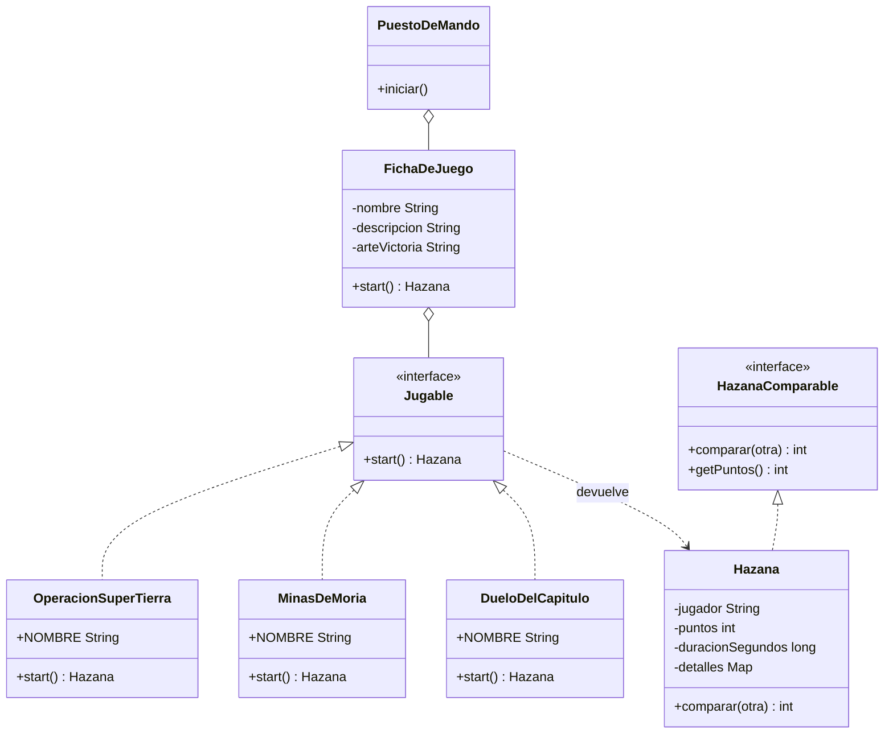
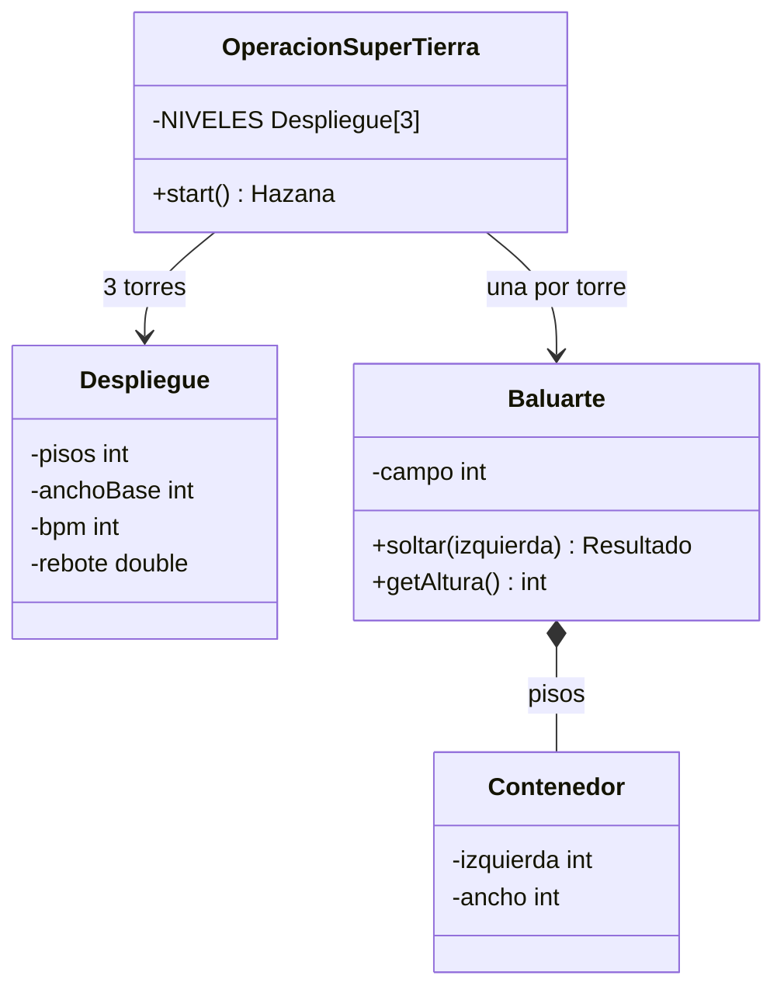
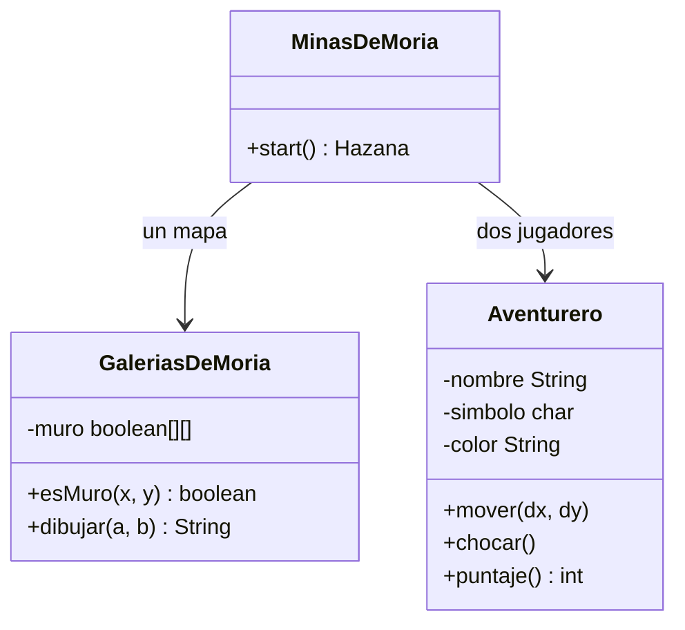
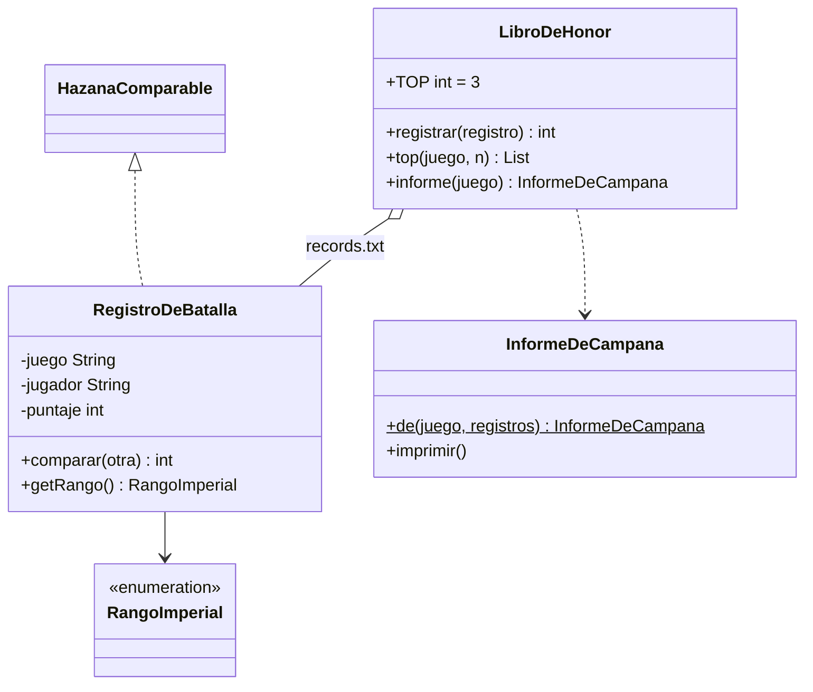

# Diagramas de clases

GitHub renderiza estos diagramas (Mermaid) directamente.

## Arquitectura general

## Torre de Super Tierra (Helldivers 2)

## Minas de Moria (El Señor de los Anillos)

## Estadísticas

